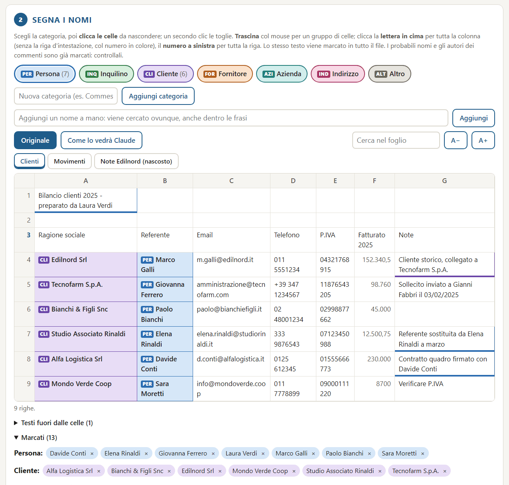

# Maschera — for spreadsheets · per fogli di calcolo

[](https://github.com/alexcard3/maschera-xlsx/actions/workflows/ci.yml)
[](https://github.com/alexcard3/maschera-xlsx/releases)
[](LICENSE)

**English** · [Italiano](#italiano)

Maschera hides the names in your spreadsheets before you show them to an AI assistant (Claude, ChatGPT…). It runs on
your own computer, inside the browser: the file never leaves your PC. When the assistant answers, Maschera puts the
real names back. It is a single HTML file, with no installation, no macros, no permissions and no internet connection.



**Spreadsheets only.** It works with Excel, LibreOffice and Google Sheets files saved as `.xlsx` or `.xlsm`; old
`.xls` files and `.csv` keep the values only. Word and PDF files are not supported.

**Status: 0.9, beta.** Tested with invented data (four automated test suites, two of them inside Excel) and on 103
real spreadsheets: numbers and number formats unchanged, every output opens in Excel without repairs. Version 1.0
comes after the first field test by a user other than the author.

## Download

- **[Download Maschera.html](https://github.com/alexcard3/maschera-xlsx/releases/latest/download/Maschera.html)**
  from the [latest release](https://github.com/alexcard3/maschera-xlsx/releases/latest).
- Optional, to check that the file is exactly the one built from this code:
  - compare its SHA-256 with `SHA256SUMS.txt` in the release (`certutil -hashfile Maschera.html SHA256` on Windows,
    `shasum -a 256 Maschera.html` on macOS and Linux);
  - or, with the [GitHub CLI](https://cli.github.com/), `gh attestation verify Maschera.html --repo alexcard3/maschera-xlsx`:
    it proves the file was built by this repository's release workflow.

## Step-by-step guide

You only need a computer with a browser (Edge, Chrome or Firefox). The buttons are in Italian; their meaning is given
in brackets.

### 1. Open Maschera
- Save `Maschera.html` in a folder of your choice, for example Documents.
- Double-click it. It opens in the browser like a web page, but it works offline too.
- If it opens in another program, right-click the file, choose **Open with** and pick your browser.

### 2. Load your spreadsheet
- Drag the file onto the dashed box, or click the box and choose the file.
- The sheet appears on screen. Names Maschera thinks are people or companies are already **coloured**, with a small
  label (PER = person, CLI = client…). Hidden sheets are shown too, among the sheet tabs.
- Password-protected files cannot be read: open them in Excel, remove the password and save a copy.

### 3. Mark what must be hidden
- **Choose a category** with the coloured buttons: Persona (person), Inquilino (tenant), Cliente (client), Fornitore
  (supplier), Azienda (company), Indirizzo (address), Altro (other). You can create new ones with
  **Aggiungi categoria** (add category).
- **Click a cell** to mark it; click it again to unmark it.
- **Drag the mouse** over a group of cells to mark them all.
- **Click a column letter** (A, B, C…) or a **row number** to mark the whole column or row. A second click unmarks.
- A name you mark is hidden **everywhere** in the file, not only in that cell.
- If a name is inside a sentence, type it in **Aggiungi un nome a mano** (add a name by hand) and press
  **Aggiungi** (add).
- Open **Testi fuori dalle celle** (texts outside cells) to see comments, print headers, text boxes and charts:
  they are not in the grid but they are in the file.
- **A− / A+** change the text size. **Cerca nel foglio** (search the sheet) finds a word.
- Tax codes, VAT numbers, IBANs, e-mails and phone numbers are hidden automatically.

### 4. Check how the assistant will see it
- Click **Come lo vedrà Claude** (how Claude will see it). Every marked name has become a code such as
  `CLIENTE_003`, always the same code for the same name. Changed cells are green.
- Click **Originale** to go back and mark more.

### 5. Download
- Click **Anonimizza e scarica** (anonymize and download).
- If Maschera still sees likely names, a window lists them and colours them **yellow**. The sheet tabs show how many
  there are in each sheet. Choose **Torno a controllare** (go back and check), mark them, and download again.
- You get **two files** in your Downloads folder:
  - `anonimo_….xlsx`: the anonymized file. **This is the one you give to the assistant.**
  - `corrispondenze_NON_CONDIVIDERE_….xlsx`: the list of codes and real names. **Never share it.** Keep it on your
    PC, outside shared or synced folders. You need it to put the names back.
- The "Fatto" (done) box lists the texts left in clear: read it quickly to make sure no name slipped through.

### 6. Put the real names back
- Open the tab **2. Rimetti i nomi veri** (put the real names back).
- Step 1: load the correspondences file. If you have just anonymized in the same window, they are already loaded;
  the page says which file they belong to.
- Step 2: paste the assistant's answer and click **Rimetti i nomi** (put the names back), then **Copia il testo**
  (copy the text).
- Step 3: or load the spreadsheet the assistant gave back, even if it changed rows, columns or sheets, and click
  **Scarica l'Excel con i nomi veri** (download the Excel with the real names). Names come back everywhere: new
  cells, sentences, new sheets and their names, comments, charts.
- **Tip:** ask the assistant to keep the codes exactly as they are (`PERSONA_001`). Codes written differently
  (`persona_001`, `PERSONA_1`) are not restored: Maschera lists them so you can fix them by hand.

**Next file:** in box 1, under the file, **Hai già anonimizzato un file simile?** (already anonymized a similar file?)
lets you load the previous correspondences. The same names then get the same codes, and the assistant can compare the
files.

## What it guarantees, and what it does not

- **Formatting is kept.** Texts are replaced inside the original `.xlsx` package, so colours, formulas, charts,
  pivots and number formats stay as they were. Old `.xls` files come out with values only: save them as `.xlsx` first.
- **Final check.** Before anything is downloaded, every part of the package is searched for real values, for folder
  paths that contain a user name, and for parts that cannot be read. If anything is found, the formatted file is not
  produced. Maschera falls back to a values-only file, or produces nothing, and says why.
- **Also cleaned:** document author, user names that Excel writes by itself, comment authors, macros and printer
  settings.
- **It is pseudonymization, not anonymization.** Anyone holding the correspondences can restore the names.
- **Not covered:**
  - PNG or JPG images are shared as they are (Maschera warns you).
  - The same name written in different ways ("ROSSI MARIO", "Rossi Mario") gets one code, and comes back in the
    first spelling found. Same for phone numbers written with different separators.
  - Names that are not marked stay in clear: the warning before download points out likely ones, but checking the
    preview is up to you.
  - Network blocking (Content-Security-Policy) stops the code from connecting. It does not stop a link you click
    yourself; the page creates none.

## For developers

The interface, the code and its comments are in Italian.

```
src/maschera.html        the page (markup, style, interface)
src/anonimizza_core.js   the logic: reading, marking, anonymizing, restoring, final check
vendor/                  SheetJS 0.20.3 and its licence
tests/                   test suites, invented data only
docs/                    screenshot and an example theme
build.py                 builds dist/Maschera.html
```

- **Build.** `python build.py` puts the page, the logic and SheetJS (sha256-checked) into a single
  `dist/Maschera.html` and adds the Content-Security-Policy. Python 3 standard library only (tested on 3.11 to 3.14);
  the tests also need Node.js (24 in CI) and `openpyxl`.
- **Develop.** Open `src/maschera.html` directly in the browser: it loads the logic and SheetJS from their files.
- **Themes.** `python build.py --tema my-theme.json` applies your own logo, colours, font and texts, for example to
  give the tool your organisation's look. See [`docs/tema-esempio.json`](docs/tema-esempio.json). Texts are inserted
  as text, never as HTML; colours and fonts are validated.
- **Tests.** They use invented data only. The first two run on every push ([workflow](.github/workflows/ci.yml));
  the Excel ones need Windows with Excel.

  | Command | What it checks |
  |---|---|
  | `pip install -r tests/requirements.txt`, `python tests/genera_prova.py <dir>`, then `node tests/collaudo.js <dir>` | the logic |
  | `node tests/collaudo_pacchetto.js` | hiding places inside the package |
  | `powershell -File tests/genera_prova_excel.ps1 <dir>`, then `node tests/collaudo_formattato.js <dir>` | a file created by Excel |
  | `powershell -File tests/apri_in_excel.ps1 <original> <anonymized>` | compares the two files inside Excel |

- **Releases.** Pushing a tag `vX.Y.Z` that matches `VERSION` runs the tests, builds the page and, in a separate job
  with write permission, attaches it to a GitHub release with its SHA-256 and the licences, and records a build
  attestation ([workflow](.github/workflows/release.yml)). The licence notices are also inside `Maschera.html`.
- **Security.** See [SECURITY.md](SECURITY.md). **Changes:** [CHANGELOG.md](CHANGELOG.md).

## Credits and licence

- The idea of replacing names locally with placeholders and restoring them locally comes from
  [rizzo-pii](https://github.com/Rizzo-AI-Academy/rizzo-pii) by Simone Rizzo.
- Spreadsheets are read with [SheetJS](https://sheetjs.com/) Community Edition (Apache 2.0): see
  [THIRD_PARTY_NOTICES.md](THIRD_PARTY_NOTICES.md).
- Maschera is released under the [MIT licence](LICENSE).

---

## Italiano

Maschera nasconde i nomi nei tuoi fogli di calcolo prima che tu li faccia vedere a un assistente AI (Claude,
ChatGPT…). Lavora sul tuo computer, dentro il browser: il file non esce mai dal PC. Quando l'assistente risponde,
Maschera rimette i nomi veri. È un solo file HTML: niente installazione, niente macro, nessun permesso, nessuna
connessione a internet.

**Solo fogli di calcolo.** Funziona con i file Excel, LibreOffice e Google Fogli salvati in `.xlsx` o `.xlsm`; i
vecchi `.xls` e i `.csv` escono con i soli valori. Word e PDF non sono gestiti.

**Stato: 0.9, beta.** Collaudato con dati inventati (quattro serie di collaudi automatici, due dentro Excel) e su 103
fogli di calcolo veri: numeri e formati numerici invariati, ogni file prodotto si apre in Excel senza riparazioni. La
versione 1.0 arriva dopo la prima prova sul campo di un utente diverso dall'autore.

## Scarica

- **[Scarica Maschera.html](https://github.com/alexcard3/maschera-xlsx/releases/latest/download/Maschera.html)**
  dall'[ultima versione](https://github.com/alexcard3/maschera-xlsx/releases/latest).
- Facoltativo, per controllare che il file sia proprio quello costruito da questo codice:
  - confronta il suo SHA-256 con `SHA256SUMS.txt` nella release (`certutil -hashfile Maschera.html SHA256` su
    Windows, `shasum -a 256 Maschera.html` su macOS e Linux);
  - oppure, con la [GitHub CLI](https://cli.github.com/),
    `gh attestation verify Maschera.html --repo alexcard3/maschera-xlsx`: dimostra che il file l'ha costruito il
    flusso di rilascio di questo repository.

## Guida passo passo

Serve solo un computer con un browser (Edge, Chrome o Firefox).

### 1. Apri Maschera
- Salva `Maschera.html` in una cartella a tua scelta, per esempio Documenti.
- Fai doppio clic. Si apre nel browser come una pagina web, ma funziona anche senza internet.
- Se si apre con un altro programma, clic destro sul file, **Apri con**, e scegli il browser.

### 2. Carica il foglio di calcolo
- Trascina il file nel riquadro tratteggiato, oppure clicca il riquadro e scegli il file.
- Il foglio compare sullo schermo. I nomi che Maschera riconosce come persone o aziende sono già **colorati**, con una
  piccola etichetta (PER = persona, CLI = cliente…). Ci sono anche i fogli nascosti, tra le schede dei fogli.
- I file protetti da password non si possono leggere: aprili in Excel, togli la password e salva una copia.

### 3. Segna cosa nascondere
- **Scegli una categoria** con i pulsanti colorati: Persona, Inquilino, Cliente, Fornitore, Azienda, Indirizzo,
  Altro. Puoi crearne di nuove con **Aggiungi categoria**.
- **Clicca una cella** per marcarla; un secondo clic la toglie.
- **Trascina il mouse** su un gruppo di celle per marcarle tutte.
- **Clicca la lettera di una colonna** (A, B, C…) o il **numero di una riga** per marcare tutta la colonna o la riga.
  Un secondo clic toglie.
- Un nome marcato viene nascosto **ovunque** nel file, non solo in quella cella.
- Se un nome sta dentro una frase, scrivilo in **Aggiungi un nome a mano** e premi **Aggiungi**.
- Apri **Testi fuori dalle celle** per vedere commenti, intestazioni di stampa, caselle di testo e grafici: non stanno
  nella griglia, ma sono nel file.
- **A− / A+** cambiano la grandezza del testo. **Cerca nel foglio** trova una parola.
- Codici fiscali, partite IVA, IBAN, email e telefoni vengono nascosti da soli.

### 4. Controlla come lo vedrà l'assistente
- Clicca **Come lo vedrà Claude**. Ogni nome marcato è diventato un codice come `CLIENTE_003`, sempre lo stesso per
  lo stesso nome. Le celle cambiate sono verdi.
- Clicca **Originale** per tornare indietro e marcare altro.

### 5. Scarica
- Clicca **Anonimizza e scarica**.
- Se Maschera vede ancora dei probabili nomi, una finestra li elenca e li colora di **giallo**. Le schede dei fogli
  dicono quanti ce ne sono in ciascuno. Scegli **Torno a controllare**, marcali e scarica di nuovo.
- Nella cartella Download trovi **due file**:
  - `anonimo_….xlsx`: il file anonimo. **È quello da dare all'assistente.**
  - `corrispondenze_NON_CONDIVIDERE_….xlsx`: l'elenco dei codici con i nomi veri. **Non va mai condiviso.** Tienilo
    sul PC, fuori dalle cartelle condivise o sincronizzate. Serve per rimettere i nomi.
- Il riquadro «Fatto» elenca i testi rimasti in chiaro: scorrilo per essere sicuro che non sia sfuggito un nome.

### 6. Rimetti i nomi veri
- Apri la scheda **2. Rimetti i nomi veri**.
- Passo 1: carica il file delle corrispondenze. Se hai appena anonimizzato nella stessa finestra sono già caricate;
  la pagina dice di quale file sono.
- Passo 2: incolla la risposta dell'assistente e clicca **Rimetti i nomi**, poi **Copia il testo**.
- Passo 3: oppure carica il foglio di calcolo che ti ha restituito l'assistente, anche se ha cambiato righe, colonne o
  fogli, e clicca **Scarica l'Excel con i nomi veri**. I nomi tornano ovunque: celle nuove, frasi, fogli nuovi e i
  loro nomi, commenti, grafici.
- **Consiglio:** chiedi all'assistente di lasciare i codici esattamente come sono (`PERSONA_001`). I codici scritti in
  un altro modo (`persona_001`, `PERSONA_1`) non vengono rimessi: Maschera li elenca, così li correggi a mano.

**File successivo:** nel riquadro 1, sotto il file, **Hai già anonimizzato un file simile?** permette di caricare le
corrispondenze precedenti. Così gli stessi nomi prendono gli stessi codici, e l'assistente può confrontare i file.

## Cosa garantisce e cosa no

- **La formattazione resta.** I testi vengono sostituiti dentro il pacchetto `.xlsx` originale, quindi colori,
  formule, grafici, pivot e formati numerici restano come erano. I vecchi `.xls` escono con i soli valori: salvali
  prima come `.xlsx`.
- **Controllo finale.** Prima di scaricare, Maschera cerca in ogni parte del pacchetto i valori veri, i percorsi delle
  cartelle che contengono un nome utente e le parti che non si possono leggere. Se trova qualcosa, il file formattato
  non esce. Maschera ripiega su un file con i soli valori, oppure non produce niente, e dice perché.
- **Toglie anche:** l'autore del documento, i nomi utente che Excel scrive da solo, gli autori dei commenti, le macro e
  le stampanti.
- **È pseudonimizzazione, non anonimizzazione.** Chi ha le corrispondenze può rimettere i nomi.
- **Cosa non copre:**
  - le immagini PNG o JPG vengono condivise così come sono (Maschera lo segnala);
  - lo stesso nome scritto in modi diversi («ROSSI MARIO», «Rossi Mario») prende un solo codice, e torna nella prima
    scrittura trovata. Lo stesso vale per i telefoni scritti con separatori diversi;
  - i nomi non marcati restano in chiaro: l'avviso prima dello scaricamento segnala i probabili, ma il controllo
    dell'anteprima tocca a te;
  - il blocco della rete (Content-Security-Policy) impedisce al codice di collegarsi. Non ferma un link cliccato da
    te; la pagina non ne crea.

## Per chi sviluppa

Interfaccia, codice e commenti sono in italiano.

```
src/maschera.html        la pagina (struttura, stile, interfaccia)
src/anonimizza_core.js   la logica: lettura, marcatura, anonimizzazione, ripristino, controllo finale
vendor/                  SheetJS 0.20.3 e la sua licenza
tests/                   collaudi, solo dati inventati
docs/                    schermata e un tema d'esempio
build.py                 costruisce dist/Maschera.html
```

- **Costruzione.** `python build.py` mette pagina, logica e SheetJS (sha256 controllato) in un solo
  `dist/Maschera.html` e aggiunge la Content-Security-Policy. Basta la libreria standard di Python 3 (provato dalla
  3.11 alla 3.14); i collaudi richiedono anche Node.js (24 nella CI) e `openpyxl`.
- **Sviluppo.** Apri `src/maschera.html` direttamente nel browser: carica logica e SheetJS dai loro file.
- **Temi.** `python build.py --tema mio-tema.json` applica logo, colori, font e testi propri, per esempio per dare
  allo strumento l'aspetto della tua organizzazione. Vedi [`docs/tema-esempio.json`](docs/tema-esempio.json). I testi
  entrano come testo, mai come HTML; colori e font vengono controllati.
- **Collaudi.** Usano solo dati inventati. I primi due girano a ogni push ([flusso](.github/workflows/ci.yml)); quelli
  con Excel richiedono Windows con Excel.

  | Comando | Cosa controlla |
  |---|---|
  | `pip install -r tests/requirements.txt`, `python tests/genera_prova.py <cartella>`, poi `node tests/collaudo.js <cartella>` | la logica |
  | `node tests/collaudo_pacchetto.js` | i nascondigli del pacchetto |
  | `powershell -File tests/genera_prova_excel.ps1 <cartella>`, poi `node tests/collaudo_formattato.js <cartella>` | un file creato da Excel |
  | `powershell -File tests/apri_in_excel.ps1 <originale> <anonimo>` | confronta i due file dentro Excel |

- **Rilasci.** Un tag `vX.Y.Z` uguale a `VERSION` fa girare i collaudi, costruisce la pagina e, in un passo separato
  con il permesso di scrittura, la allega a una release di GitHub con il suo SHA-256 e le licenze, e registra
  un'attestazione di costruzione ([flusso](.github/workflows/release.yml)). Gli avvisi di licenza sono anche dentro
  `Maschera.html`.
- **Sicurezza.** Vedi [SECURITY.md](SECURITY.md). **Modifiche:** [CHANGELOG.md](CHANGELOG.md).

## Ringraziamenti e licenza

- L'idea di sostituire i nomi in locale con dei segnaposto e di rimetterli in locale viene da
  [rizzo-pii](https://github.com/Rizzo-AI-Academy/rizzo-pii) di Simone Rizzo.
- I fogli di calcolo si leggono con [SheetJS](https://sheetjs.com/) Community Edition (Apache 2.0): vedi
  [THIRD_PARTY_NOTICES.md](THIRD_PARTY_NOTICES.md).
- Maschera è distribuito con [licenza MIT](LICENSE).
